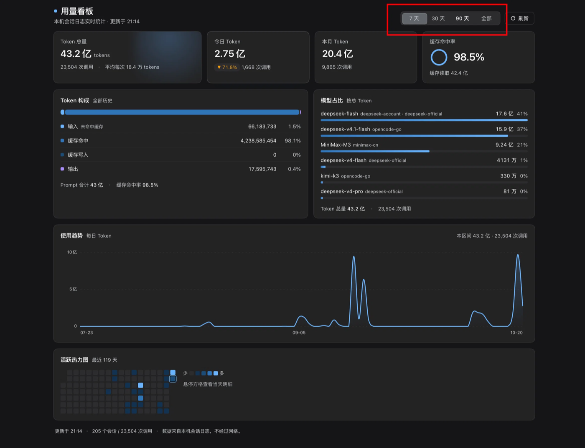

# dsh-usage-panel · Token 用量看板

[](LICENSE)

DeepSeek Harness 的本地优先 Token 用量看板插件：侧边栏入口 + 整页看板。所有数字都由本机会话日志实时聚合，不联网，不读取价格、账户或余额。



> **English** — A local-first token-usage dashboard for DeepSeek Harness. It adds a sidebar entry beside *Plugins* and renders a full-page panel with lifetime / today / month totals, output speed, cache hit rate, token composition, model share, daily trend, activity heatmap, and an hourly per-provider speed / first-token performance chart. Every number is derived from local session logs: no network calls, no pricing, no account data.

## 功能

| 区域 | 内容 |
|---|---|
| **读数条** | Token 总量（调用次数 / 平均每次）、今日（较昨日变化）、本月、平均输出速度（tok/s）、缓存命中率（环形仪表） |
| **Token 构成** | 输入（未命中缓存）/ 缓存命中 / 缓存写入 / 输出的堆叠比例条与逐项计数、占比 |
| **模型占比** | 按 Token 降序的模型份额，含 provider 标签与份额条 |
| **使用趋势** | 平滑日趋势，`7 天 / 30 天 / 90 天 / 全部` 四档，悬浮十字线提示、方向键逐日浏览、区间日均 |
| **活跃热力图** | 最近 119 天逐日方格；**点击任意方格可切换下方性能面板的日期** |
| **提供商性能** | 选中日期按小时、按 provider 的 `速度 / 首 Token` 双指标折线，悬浮查看各 provider 数值，非今天时可「回到今天」 |

状态与细节：首次读取显示骨架屏；空数据、读取失败、同步失败各有独立状态；页脚展示更新时间、扫描会话数与不可读会话数。界面跟随宿主亮/暗主题，动效在 `prefers-reduced-motion` 下自动退化为静态。

## 安装

环境要求：DeepSeek Harness Desktop（Web UI profile），Node.js `>= 20`。

本仓库本身就是一个可直接安装的 bundle，无构建步骤：

```bash
git clone https://github.com/chunrichi/dsh-usage-panel.git
```

然后在 Harness 中执行（target 换成本地克隆的**绝对路径**）：

```
plugin_manager action=install_bundle target=/absolute/path/to/dsh-usage-panel
```

安装后侧边栏面板列表会多出一个看板图标（紧邻「插件」入口）。如果界面还没变化，刷新一次窗口即可加载新的客户端模块。

## 入口与交互

- 侧边栏入口位于 `sidebar.panellist`，`order: 1`，紧挨「插件」入口；主面板注册在 `main` 槽的 `usage-panel` 键上。
- 点开看板后中栏整页显示；再次点击其它面板即返回原会话。
- 点击热力图格子切换「提供商性能」的日期；点击当天或「回到今天」恢复。
- 「提供商性能」支持 `速度` / `首 Token` 标签切换，折线按 provider 分色，图例标注样本数。

## 数据口径

一次「读数」= 一条 `assistant/message` 事件的 `data.usage`（Anthropic Messages 语义）：

- `input` = `usage.inputTokens`：**未命中缓存**的输入，不包含缓存读写。
- `cacheRead` / `cacheWrite` = `usage.cacheReadTokens` / `cacheWriteTokens`：独立计数，不是 `input` 的子集。
- `output` = `outputTokens`；`reasoning` = `reasoningTokens`（含在输出内，不重复计入总量）。
- `prompt` = `input + cacheRead + cacheWrite`；`tokens` = `prompt + output`。
- `cacheHitRate` = `cacheRead / prompt`。
- `calls` = 读数条数；按服务器本地时区分日/月。
- **输出速度**：从每个 step 的 durable stream 取「首个 token → 落盘」解码窗口，`tps = outputTokens / 解码秒数`；与 Chat 面板 detailed 模式的 tok/s 同口径。
- **首 Token**：`首个 token 时间 − step/start`。性能面板按「本地日期 × 小时 × provider」聚合，速度与首 Token **均取中位数**，避免休眠或排队长尾拉高均值。
- 更早的日志若没有 durable stream 时间，只参与速度统计、不参与首 Token；该日可能显示「暂无性能样本」。

## 配置

在 bundle patch 行 `config` 中调整（Host 侧做防御式归一化）：

| 键 | 类型 | 默认 | 范围 | 说明 |
|---|---|---|---|---|
| `historyDays` | 整数 | `182` | 7–365 | 日趋势 / 热力图 / `daily` 数组的窗口天数 |
| `maxSessions` | 整数 | `800` | 1–5000 | 最多扫描的会话数（按 `createdAt` 取最新），超出时页脚会标注 |

```yaml
- insert:
    - id: usage-panel
      name: dsh-usage-panel
      config:
        historyDays: 182
        maxSessions: 800
```

## 实现与性能

- **Host 半边**（`index.js`）：通过 `sessionPersistence` 读取本机会话日志，逐会话按稳定 revision 增量缓存读数；整份快照按「会话签名 + 配置 + 本地日期」缓存。启动后约 4s 在后台静默预热一次；解码失败的会话进入 10 分钟退避门，不会让每次轮询都付出重试代价。
- **Client 半边**（`client.js`）：零第三方依赖；快照在模块内缓存并对 7s 后的首次打开预热；仅在看板挂载且页面可见时每 60s 静默刷新。数字用单个 `requestAnimationFrame` 直接写文本节点，动画只使用 `transform` / `opacity`，图表悬浮仅在跨天时更新 state。
- **只读路由**：
  - `GET|HEAD /dsh-usage-panel/snapshot[?refresh=1][&debug=1]`
  - `GET|HEAD /dsh-usage-panel/performance?date=YYYY-MM-DD`
  - 响应 `application/json; charset=utf-8`、`cache-control: no-store`；`?debug=1` 附带读取诊断。
- **实测**（约 200 个会话 / 2.3 万次读数）：热读约 25–80ms，按日性能折叠约 25ms；首次冷读 3–6s，由后台预热吸收。

## 兼容性与限制

- 面向 DeepSeek Harness Desktop 的 Web UI profile 开发（插件清单 `dsh.client.platform = web`）；依赖的 Slot / Service 均为宿主公开 API，宿主大版本升级后可能需要适配。
- 只读：不修改会话日志、不产生额外数据、不发起网络请求。
- 仅统计当前 `sessionPersistence` 可见的会话；历史日志被清理后对应数字会减少；`maxSessions` 截断时更早会话不计入。
- 更早格式的会话日志可能无法被当前存储后端解码，会被跳过并在页脚标注，不影响其它数据。
- 不包含费用估算、余额或价格表。

## 开发

无需构建，仓库文件即产物；语法检查：

```bash
node --check client.js
node --input-type=module --check < index.js
```

Host 侧的接口契约、缓存策略与性能设计记录在 [docs/CONTRACT.md](docs/CONTRACT.md)。改完代码重新执行一次 `install_bundle` 即可让 Host 半边加载新模块；客户端改动刷新窗口生效。

## 许可证

[MIT](LICENSE) © 2026 chunrichi
