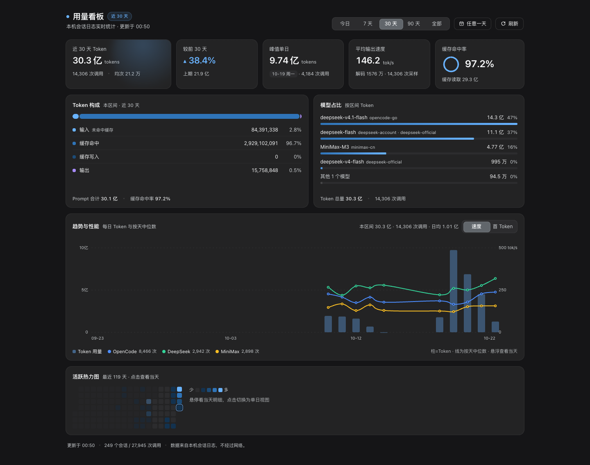
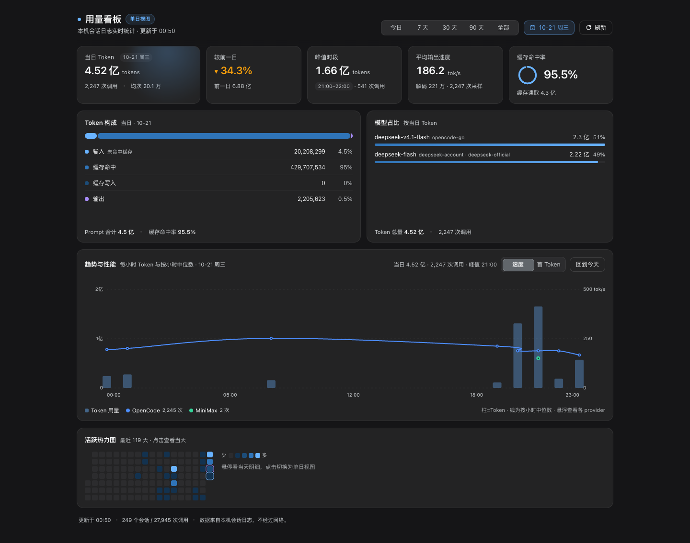

# dsh-usage-panel · Token 用量看板

[](LICENSE)
[](https://github.com/topics/dsh-plugin)
[](https://github.com/deepseek-ai/deepseek-harness)

DeepSeek Harness 的本地优先 Token 用量看板插件：侧边栏入口 + 整页看板，顶部一条**全局时间作用域**（今日 / 7 天 / 30 天 / 90 天 / 全部，以及任意一天日历），切换后整块看板一起跟随。所有数字都由本机会话日志实时聚合，不联网，不读取价格、账户或余额。





> **English** — A local-first token-usage dashboard for DeepSeek Harness. It adds a sidebar entry beside *Plugins* and renders a full-page panel with a global time scope (today / 7 / 30 / 90 days / all time, plus an any-day calendar), single-day 24-hour detail, scoped overview cards, token composition, model share, activity heatmap, and a dual-axis trend & performance chart that overlays daily or hourly token bars with per-provider speed / first-token medians (hourly within a day, daily across a range), all in one chart with a shared tooltip. Every number is derived from local session logs: no network calls, no pricing, no account data.

## 功能

| 区域 | 内容 |
|---|---|
| **时间作用域** | 顶部 sticky 作用域条：`今日 / 7 天 / 30 天 / 90 天 / 全部`，以及「日期」按钮打开的自绘月历（任意一天）。切换后下面所有面板一起跟随，作用域在面板切走再切回时保留 |
| **读数条** | 5 张卡随作用域变化：区间 = 近 N 天 Token / 较前 N 天 / 峰值单日 / 区间加权输出速度 / 区间缓存命中率；单日 = 当日 Token / 较前一日 / 峰值时段 / 当日速度 / 当日命中率；全部 = Token 总量 / 活跃日均 / 全历史峰值单日 / 全历史速度 / 全历史命中率 |
| **Token 构成** | 输入（未命中缓存）/ 缓存命中 / 缓存写入 / 输出的堆叠比例条与逐项计数、占比，hint 标注当前作用域 |
| **模型占比** | 当前作用域按 Token 降序的模型份额，含 provider 标签与份额条；区间与单日使用快照的按日模型表 |
| **趋势与性能** | 使用趋势与提供商性能合并为一张双轴组合图，共享 x 轴（区间 / 全部按本地日，单日按小时）：左轴为 Token 用量柱状，右轴为提供商性能折线（`速度` / `首 Token` 标签切换，区间 / 全部按天中位数、单日按小时中位数）；一个悬浮 tooltip 同时给出 Token、调用次数、缓存命中、速度与各 provider 数值，图例含「Token 用量」与 provider 样本数，方向键逐日 / 逐小时浏览 |
| **活跃热力图** | 最近 119 天逐日方格；区间外格子压暗，**点击任意方格把整块看板切到该日** |

状态与细节：首次读取显示骨架屏；空数据、读取失败、同步失败各有独立状态，作用域内没有用量时给友好空文案（如「该日暂无用量与性能样本」）。切换作用域时数字做一次平滑过渡；切换区间时组合图的柱状立即跟随新作用域、provider 折线等性能数据返回后再绘制；切换单日时保留旧图暗化与加载浮层，面板高度恒定、不跳动。页脚展示更新时间、扫描会话数与不可读会话数。界面跟随宿主亮/暗主题，动效在 `prefers-reduced-motion` 下自动退化为静态；响应式在 ≤980px 收窄读数条、≤900px 面板转单列、≤640px 单列紧凑布局（作用域条取消吸顶），日历 popover 在窄屏不会溢出视口。

## 安装

环境要求：DeepSeek Harness Desktop（Web UI profile），Node.js `>= 20`。仓库自带构建产物、没有 `prepare` 脚本，因此从 GitHub 安装**不需要构建**。

### 方式一：直接从 GitHub 安装（推荐）

使用 DSH CLI（在任意目录执行；`web` 换成目标 profile 名）：

```bash
dsh plugin --profile web add github:chunrichi/dsh-usage-panel
```

或在 Harness 的插件管理页 / 交给 Agent 安装（`desktop` profile 推荐这条，可热应用）：

```
plugin_manager action=install_bundle target=github:chunrichi/dsh-usage-panel
```

- CLI 会把剩余参数转发到 `$DSH_HOME/profiles/<profile>`，在 profile 目录执行 `pnpm add github:...`；安装成功后自动把 `dsh-usage-panel` 加入该 profile 的 `dsh.profile.bundles`，下次启动生效。
- `desktop` 是 Desktop 保留 profile：需要完全退出 Desktop 后再执行，并且要用 **Desktop 自带的 CLI**（macOS 路径：`DeepSeek Harness.app/Contents/Resources/runtime/cli/bin/dsh`）；用普通 npm 安装的 `dsh` 操作 desktop profile 会被拒绝（`profile "desktop" is managed exclusively by the Electron application`）。在应用内安装则立即热应用、无需退出。
- 切换版本：先 `dsh plugin --profile web remove dsh-usage-panel`，再重新 `add`。
- 固定版本可以带 ref：`github:chunrichi/dsh-usage-panel#v1.1.0`。

### 方式二：本地目录安装（改代码时使用）

```bash
git clone https://github.com/chunrichi/dsh-usage-panel.git
```

然后在 Harness 中安装本地目录（target 用**绝对路径**）：

```
plugin_manager action=install_bundle target=/absolute/path/to/dsh-usage-panel
```

本地目录以 `link:` 依赖接入：修改源码后重新执行一次 `install_bundle` 即可让 Host 半边加载新模块，客户端改动刷新窗口生效。

安装后侧边栏面板列表会多出一个看板图标（紧邻「插件」入口）。如果界面还没变化，刷新一次窗口即可加载新的客户端模块。

### 安装机制（简述）

`dsh plugin`、插件管理页和 Agent 的安装工具背后共用 `@deepseek-ai/dsh-plugin-manager` 的同一套操作：

1. 解析 spec：registry 包名、本地路径、`github:` / `git+` 等 git 地址、tarball 四类；
2. git 地址先做一次受超时限制的 GitHub 连接检查（只把网络错误判为失败，鉴权与传输交给 pnpm）；
3. 在 profile 目录执行 pnpm 操作，把包写进 profile 的 `package.json` 与 `node_modules`；
4. 安装后校验 `engines` / `peerDependencies` 兼容性，并读取新包的 `dsh.bundle.patch`；
5. 把包名写进 profile 的 `dsh.profile.bundles`，使它成为该 profile 的一层 patch；
6. 应用内安装会继续热应用 Host 行并刷新客户端 bundle；CLI 只改 profile 文件，因此下次启动生效。

本仓库根目录的 `package.json` 同时声明了 `dsh.bundle.patch`（Host 插件行）与 `dsh.client`（Web 客户端模块），并已提交运行时代码，所以 `github:` 安装即可直接使用。

## 入口与交互

- 侧边栏入口位于 `sidebar.panellist`，`order: 1`，紧挨「插件」入口；主面板注册在 `main` 槽的 `usage-panel` 键上。
- 点开看板后中栏整页显示；再次点击其它面板即返回原会话。
- **作用域条**：位于看板顶部并吸顶——页面滚动时保持可见，下方带毛玻璃渐隐。左侧标题旁的徽标显示当前作用域（「近 30 天」「单日视图」「全部历史」）；右侧是 `今日 / 7 天 / 30 天 / 90 天 / 全部` 分段控件（选中态为滑动 pill）、「日期」按钮和刷新按钮。切换任一项，读数条、Token 构成、模型占比、趋势与性能、活跃热力图全部跟随。
- **任意一天**：点「日期」按钮打开自绘月历——周一开头、可翻上/下月；**有用量的日期带圆点**、今天描边、选中日期填充；可选范围限制在快照窗口（默认最近 182 天）内，窗口外的日期禁用；底部有「回到今天」，Escape 或点击外部关闭。选中某日后整块看板进入单日视图，日期按钮显示 `MM-DD 周X`。
- **热力图**：悬停任意方格查看当天 Token 与调用次数；点击任意方格（包括区间外压暗的格子）把整块看板切到该日；单日视图里选中格有描边。
- **趋势与性能**：使用趋势与提供商性能合并为一张双轴组合图——共享 x 轴（区间 / 全部按本地日，单日按小时），左轴为 Token 用量柱状，右轴为提供商性能折线；`速度` / `首 Token` 标签切换，区间 / 全部为按天中位数、单日为按小时中位数。悬浮时一个 tooltip 同时给出该日 / 该小时的 Token、调用次数、缓存命中、速度与各 provider 数值；图例含「Token 用量」与各 provider 样本数（区间模式为区间汇总），右侧提示为「柱=Token · 线为按天中位数」/「柱=Token · 线为按小时中位数」；方向键逐日 / 逐小时浏览。
- **回到今天**：「趋势与性能」标题栏的「回到今天」只在单日且非今天时出现；日历底部也有同名按钮。
- **单日明细**：读数条改为当日 Token / 较前一日 / 峰值时段 / 当日速度 / 当日命中率；Token 构成、模型占比均按当日重算；「趋势与性能」切换为按小时组合图，今天的柱状只画到当前小时并在当前小时处标注「今日」，0 点档显示「今天刚开始，用量会随时间累积」；当该日有 Token 用量、但 Host 没有返回可用的小时桶时，组合图显示「该日暂无小时明细数据」，而不是笼统的空态。
- **加载不跳**：切换区间时柱状立即跟随新作用域、provider 折线等 `/performance` 返回后再绘制（旧线不会画到新时间轴上）；切换单日时保留旧图暗化 + 加载浮层，面板高度与滚动位置保持不变。

## 数据口径

一次「读数」= 一条 `assistant/message` 事件的 `data.usage`（Anthropic Messages 语义）：

- `input` = `usage.inputTokens`：**未命中缓存**的输入，不包含缓存读写。
- `cacheRead` / `cacheWrite` = `usage.cacheReadTokens` / `cacheWriteTokens`：独立计数，不是 `input` 的子集。
- `output` = `outputTokens`；`reasoning` = `reasoningTokens`（含在输出内，不重复计入总量）。
- `prompt` = `input + cacheRead + cacheWrite`；`tokens` = `prompt + output`。
- `cacheHitRate` = `cacheRead / prompt`。
- `calls` = 读数条数；按服务器本地时区分日/月。
- **输出速度**：从每个 step 的 durable stream 取「首个 token → 落盘」解码窗口，`tps = outputTokens / 解码秒数`；与 Chat 面板 detailed 模式的 tok/s 同口径。
- **首 Token**：`首个 token 时间 − step/start`。组合图中的性能折线按「本地日期 × 小时 × provider」聚合，速度与首 Token **均取中位数**，避免休眠或排队长尾拉高均值。
- 更早的日志若没有 durable stream 时间，只参与速度统计、不参与首 Token；对应小时 / 日期的折线可能没有样本（tooltip 显示「该小时无样本」/「该日无样本」）。

**时间作用域**（所有卡片与面板共用同一份作用域状态）：

- **区间（7 / 30 / 90 天）**：由快照 `daily[]` 的最近 N 个本地自然日求和；「较前 N 天」取紧邻的等长前一段窗口（窗口不足时显示「—」「暂无对比数据」）；速度与缓存命中率为区间加权口径；「峰值单日」取区间内 Token 最大的一天。
- **单日（今日或任意一天）**：取 `daily[]` 中该日一行（与今日相同的聚合口径）；「较前一日」对比前一天；峰值时段取自该日 `/performance` 的小时用量桶（单日 Token 最多的整点小时）；「趋势与性能」的每小时 Token 柱状同样来自小时用量桶，缺失小时按 0 补位。
- **全部**：直接使用快照 `totals / speed / history`——`history.peak` 是全历史峰值单日，`history.activeDays` 是「活跃日均」的分母，速度与命中率为全历史加权口径。
- 快照 `daily[]` 由 Host 按本地时区聚合，默认覆盖最近 182 天（`historyDays`）；日历与热力图的可选范围不会超出该窗口。
- **趋势与性能（组合图）**：共享 x 轴由快照 `daily[]`（区间 / 全部，每日一根 Token 柱）或 `/performance` 的小时用量桶（单日，每小时一根柱）驱动；左轴为 Token 柱状，右轴为提供商性能折线——区间 `?from=&to=` 按天、单日按小时取各 provider 的中位数，`速度 / 首 Token` 可切换；图例中的 provider 样本数在区间模式为区间汇总。悬浮 tooltip 同时给出该日 / 该小时的 Token、调用次数、缓存命中、速度与各 provider 指标；今天直接复用快照内嵌的 `performance` 块。

## 配置

在 bundle patch 行 `config` 中调整（Host 侧做防御式归一化）：

| 键 | 类型 | 默认 | 范围 | 说明 |
|---|---|---|---|---|
| `historyDays` | 整数 | `182` | 7–365 | 组合图 / 热力图 / `daily` 数组的窗口天数，同时限定日历可回看的范围 |
| `maxSessions` | 整数 | `800` | 1–5000 | 最多扫描的会话数（按 `createdAt` 取最新），超出时页脚会标注 |

```yaml
- insert:
    - id: usage-panel
      name: dsh-usage-panel
      config:
        historyDays: 182
        maxSessions: 800
```

## 实现与性能

- **Host 半边**（`index.js`）：通过 `sessionPersistence` 读取本机会话日志，逐会话按稳定 revision 增量缓存读数；整份快照按「会话签名 + 配置 + 本地日期」缓存。启动后约 4s 在后台静默预热一次；解码失败的会话进入 10 分钟退避门，不会让每次轮询都付出重试代价。快照 `version: 2`：`daily[]` 新增 `models / reasoning / samples / decodeTokens / decodeMs`，`history` 新增 `activeDays / firstDay / lastDay / peak`，`/performance` 的 `hours[]` 带小时用量桶；这些字段供区间模型占比、单日读数条、组合图的每小时柱状与性能折线直接使用。
- **Client 半边**（`client.js`）：零第三方依赖；快照在模块内缓存并对 7s 后的首次打开预热；仅在看板挂载且页面可见时每 60s 静默刷新。作用域状态保存在模块级，面板重挂载不丢。提供商性能按请求参数（`date` 或 `from..to`）在客户端缓存 30s。组合图是单一的双轴 SVG 组件：柱状直接来自快照（切换区间立即更新），provider 折线等 `/performance` 返回后才绘制，旧线不会串到新时间轴上；切换单日时保留旧图暗化 + 加载浮层，面板高度恒定。数字用单个 `requestAnimationFrame` 直接写文本节点（不走 React state），其它动效只使用 `transform` / `opacity`，切换作用域时数字做一次 820ms 缓动过渡。图表宽度在首次绘制前同步测量，因此切换作用域或日期不会触发整页重排或滚动跳位。
- **只读路由**：
  - `GET|HEAD /dsh-usage-panel/snapshot[?refresh=1][&debug=1]`
  - `GET|HEAD /dsh-usage-panel/performance?date=YYYY-MM-DD`（单日；今天通常直接复用快照内嵌的 `performance`）
  - `GET|HEAD /dsh-usage-panel/performance?from=YYYY-MM-DD&to=YYYY-MM-DD`（区间，跨度上限 400 天；非法参数返回 400）
  - 响应 `application/json; charset=utf-8`、`cache-control: no-store`；`?debug=1` 附带读取诊断。
- **实测**（约 200 个会话 / 2.3 万次读数）：热读约 25–80ms；按日或按区间的性能折叠约 25ms（区间模式每次从内存 records 实时折叠，不新增缓存）；首次冷读 3–6s，由后台预热吸收。

## 兼容性与限制

- 面向 DeepSeek Harness Desktop 的 Web UI profile 开发（插件清单 `dsh.client.platform = web`）；依赖的 Slot / Service 均为宿主公开 API，宿主大版本升级后可能需要适配。
- Host 快照为 v2 增量：旧字段全部保留，新增字段在客户端做了缺省降级（缺按日模型表时模型占比回退到全历史模型按比例缩放，缺解码窗口时速度回退到日 `tokensPerSecond`），因此 Host / Client 可以分别升级。
- 只读：不修改会话日志、不产生额外数据、不发起网络请求。
- 仅统计当前 `sessionPersistence` 可见的会话；历史日志被清理后对应数字会减少；`maxSessions` 截断时更早会话不计入。
- 组合图 / 热力图 / 日历只能看到 `historyDays` 窗口内的日期（默认 182 天）；更早的读数仍计入总量与全部历史峰值。
- 更早格式的会话日志可能无法被当前存储后端解码，会被跳过并在页脚标注，不影响其它数据。
- 不包含费用估算、余额或价格表。

## 开发

无需构建，仓库文件即产物；语法检查：

```bash
node --check client.js
node --input-type=module --check < index.js
```

Host 侧的接口契约、缓存策略与性能设计记录在 [docs/CONTRACT.md](docs/CONTRACT.md)。改完代码重新执行一次 `install_bundle` 即可让 Host 半边加载新模块；客户端改动刷新窗口生效。

## 许可证

[MIT](LICENSE) © 2026 chunrichi
